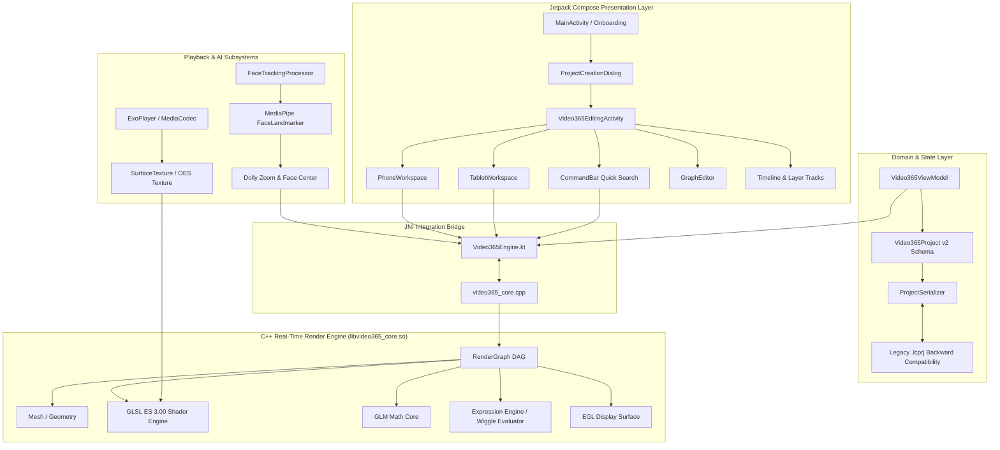

# Video365: Current System Architecture

## 1. System Topology

---

## 2. Component Breakdown

### 2.1 UI Presentation Layer
- **`ProjectCreationDialog.kt`**: Prompts the user on startup for aspect ratio configurations (`9:16`, `16:9`, `1:1`, `4:5`).
- **`EditorScreen.kt`**: Breakpoint-based responsive layout:
  - Phone (<600dp): Preview viewport, Action Toolbar (`Trim`, `Split`, `FX`, `AI Dolly`, `⚡ Commands`), and single-scroll multi-track timeline.
  - Tablet (≥600dp): Multi-column studio workspace with Project Bin, Viewport, Timeline, Effect Controls, and `GraphEditor`.
- **`CommandBar.kt`**: Mobile equivalent of After Effects `Ctrl+Enter` fuzzy search palette.
- **`GraphEditor.kt`**: Interactive Bézier curve and tangent handles for keyframe interpolation.

### 2.2 Native C++ Engine (`libvideo365_core.so`)
- **`video365_renderer.cpp`**: Configures EGL context (`EGL_CONTEXT_CLIENT_VERSION = 3`), compiles vertex/fragment shaders, manages OES textures, and runs the render loop.
- **`render_graph.cpp`**: Maintains node dependencies, layer stack matrices (`WorldMatrix = ParentMatrix * LocalMatrix`), blend modes, and opacity.
- **`shaders.h`**: Comprehensive GLSL ES 3.00 shader definitions for transitions (Glitch, Whip Pan, Dissolve, Zoom, Film Burn, Radial Blur) and effects (Lumetri Color, Chromatic Aberration, Dolly Zoom, Object Track).
- **`expression_engine.cpp`**: High-speed C++ expression evaluator for per-frame mathematics and `wiggle(freq, amp)`.

### 2.3 Serialization & Data Compatibility
- **`ProjectModels.kt`**: Full v2 JSON schema with compositions, layers, keyframes, expressions, render cache segments, and thermal policies.
- **`ProjectSerializer.kt`**: Dual-parser preserving legacy `.lcprj` format and serializing/deserializing v2 project files.

